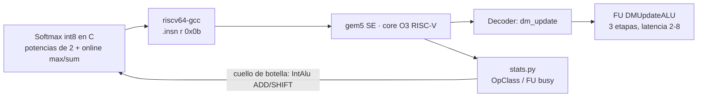

# Int8 Softmax acceleration with a custom RISC-V instruction (gem5)
> Custom instruction set extension and functional unit for integer-only softmax on a scalar RISC-V core. Cuts simulated execution time by 21.6–35.7% (3-cycle unit) for Transformer attention on edge devices.

[Español](#español) · [English](#english)

**Context:** Multidisciplinary Project, MSc Computer Science and Engineering, Politecnico di Milano (A.Y. 2025-26). Advisor: Tommaso Spagnolo. Co-advisor: Prof. Cristina Silvano.

> This repository is a fork of [gem5](https://github.com/gem5/gem5) v25.0. My work is in `src/softmax/` plus a few files of the simulator (listed below). Everything else is upstream gem5, under its BSD license (original README in `README.gem5.md`).

---

## Español

### El problema
La softmax aparece en cada bloque de self-attention de un Transformer. Las multiplicaciones de matrices ya tienen MACs y hardware paralelo, así que las operaciones no lineales como la softmax pasan a ser el cuello de botella, sobre todo en cores escalares de edge con modelos cuantizados a 8 bits.

### Qué hice
1. **Softmax solo con enteros, en C** (int8, siguiendo ITA y Softermax). Las exponenciales se reemplazan por potencias de 2 que se calculan con *shifts* (bucketización con `K_A = 5` para B = 8 bits). El máximo y el denominador se acumulan *online* en una sola pasada, renormalizando cuando aparece un nuevo máximo. La normalización final usa un único recíproco en punto fijo Q0.7.
2. **Análisis de cuellos de botella en gem5.** Un script (`stats.py`) clasifica las instrucciones ejecutadas. La IntAlu es la única unidad ocupada (hasta 68% de los ciclos) y las operaciones tipo ADD y SHIFT dominan.
3. **Instrucción custom `dm_update`** (OnlineDM, R-type, opcode *custom-0* `0x0B`). Procesa 4 elementos int8 empaquetados en `rs2` y actualiza en un solo paso el estado (cuenta, máximo y suma parcial Q0.7 de 16 bits) empaquetado en `rs1`. Se invoca con `.insn r 0x0b, 0, 0, rd, rs1, rs2`, sin tocar el toolchain.
4. **Una unidad funcional nueva** (`DMUpdateALU`, OpClass `DMUpdateOp`) en la etapa de ejecución del core O3. Está segmentada en 3 etapas (desempaquetado y máximos de a pares, luego máximo local y reescalado, luego aportes y árbol de sumas) con latencia configurable.

### Setup de simulación
gem5 v25.0 en modo SE, con un core RISC-V O3 *out-of-order* a 1 GHz. Caches L1I y L1D privadas de 32 kB, L2 de 256 kB y DDR3-1600 de 2 GB (`src/softmax/run_config.py`).

### Resultados (SimTicks × 10⁶; menos es mejor)

| Implementación | 1.024 el. | 8.192 el. | 32.768 el. |
|---|---|---|---|
| Baseline solo enteros | 134,77 | 732,52 | 2.778,18 |
| Custom, latencia 2 | 105,39 (−21,80%) | 482,45 (−34,14%) | 1.778,49 (−35,98%) |
| **Custom, latencia 3** | **105,63 (−21,62%)** | **484,74 (−33,83%)** | **1.786,73 (−35,69%)** |
| Custom, latencia 4 | 105,89 (−21,43%) | 486,69 (−33,56%) | 1.794,93 (−35,39%) |
| Custom, latencia 8 | 106,88 (−20,69%) | 494,69 (−32,47%) | 1.827,43 (−34,22%) |

- La mejora va de **~21% a ~36%** y crece con el tamaño del vector, aunque con rendimiento decreciente: entre 8.192 y 32.768 elementos se gana menos de 2 puntos.
- **Casi no depende de la latencia.** Pasar de 2 a 8 ciclos cuesta menos de 1,8 puntos, porque la instrucción solo se ejecuta ⌈(N−1)/4⌉ veces. Eso da margen para elegir la implementación de hardware.

### Archivos clave
| Archivo | Qué contiene |
|---|---|
| `src/arch/riscv/isa/decoder.isa` | Decodificación y semántica de `dm_update` |
| `src/cpu/o3/FuncUnitConfig.py`, `FUPool.py`, `src/cpu/FuncUnit.py`, `src/cpu/op_class.hh` | Nueva FU y OpClass |
| `src/softmax/C/softmax_int8.c` · `softmax_int8_custom.c` | Kernel base y kernel con la instrucción |
| `src/softmax/build_lm.sh` · `run_config.py` · `stats.py` | Cross-compilación, simulación y análisis |

---

## English

### The problem
Softmax runs inside every self-attention block of a Transformer. Matrix multiplications already have MAC arrays and parallel hardware, so non-linear operations like softmax become the bottleneck. This is worst on scalar edge cores running 8-bit quantized models.

### What I built
1. **Integer-only int8 softmax in C**, following ITA and Softermax. Exponentials become shift-based powers of two (bucketization with `K_A = 5` for B = 8). The max and the denominator are computed online in a single pass, with renormalization whenever a new max appears. A single Q0.7 fixed-point reciprocal does the final normalization.
2. **Bottleneck analysis in gem5.** A script (`stats.py`) breaks down the executed instructions. The IntAlu is the only busy unit (up to 68% of cycles), dominated by ADD-like and SHIFT-like operations.
3. **Custom instruction `dm_update`** (OnlineDM, R-type, *custom-0* opcode `0x0B`). It consumes 4 packed int8 elements from `rs2` and updates the packed state in `rs1` (count, running max and 16-bit Q0.7 partial sum) in one step. It is issued with `.insn r 0x0b, 0, 0, rd, rs1, rs2`, so the toolchain needs no changes.
4. **A new pipelined functional unit** (`DMUpdateALU` / `DMUpdateOp`) in the O3 core's execute stage. It has a 3-stage design and a configurable latency.

### Results
Measured on gem5 v25.0 (SE mode) with a single-core O3 RISC-V at 1 GHz, 32 kB L1I and L1D, 256 kB L2 and DDR3-1600. See the table above. With a 3-cycle unit, execution time drops by **21.62% / 33.83% / 35.69%** for 1,024 / 8,192 / 32,768 elements. Going from 2 to 8 cycles of latency changes the speedup by less than 1.8 points.

### My role
Individual project. Every commit on top of upstream gem5 (Oct 2025 to Jan 2026) is mine. I did the algorithm, the C kernels, the ISA and functional-unit changes in gem5, the experiments and the report. Grade: 30/30.

### References
ITA (Paulin et al., 2023, arXiv:2307.03493) · Softermax (Stevens et al., 2021, arXiv:2103.09301) · gem5 (Binkert et al., 2011).
